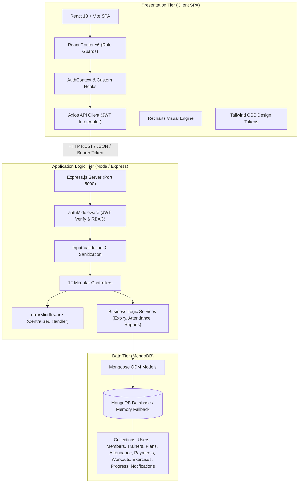

# System Architecture & Technical Specifications
## TitanPulse Gym Management System (MERN Stack)

---

## 1. 3-Tier Enterprise Architecture

TitanPulse employs a decoupled, production-grade 3-Tier Architecture designed for high availability, security, and low latency:

### 1.1 Presentation Tier (Frontend Client)
- **Framework:** React 18 with Vite bundling for instant Hot Module Replacement (HMR) and optimized rollup production bundles.
- **Styling Architecture:** Tailwind CSS utility tokens with customized glassmorphism classes (`.glass-card`, `.glass-panel`).
- **Routing & RBAC:** `react-router-dom` v6 with custom `ProtectedRoute` higher-order components checking JWT authentication and role authorization.
- **State Management:** React Context API (`AuthContext`) for session persistence and reactive authentication status updates.
- **HTTP Transport:** Axios with interceptor injection of `Authorization: Bearer <token>` and automatic 401 unauthenticated redirect handling.

### 1.2 Application Logic Tier (Express REST Server)
- **Framework:** Express.js running on Node.js.
- **Middleware Pipeline:**
  1. `cors`: Restricts cross-origin requests to configured domains.
  2. `express.json()`: Parses incoming JSON payloads up to 10MB.
  3. `morgan`: Detailed HTTP request logging.
  4. `authMiddleware.protect`: Cryptographically verifies incoming JWT tokens.
  5. `authMiddleware.authorize`: Restricts access based on user role (`admin`, `trainer`, `member`).
  6. `errorMiddleware.errorHandler`: Intercepts and formats all exceptions (CastError, Duplicate Key 11000, ValidationError).
- **Service Layer:** Decoupled business rules (e.g., date arithmetic for membership duration, duplicate attendance queries, revenue aggregations).

### 1.3 Data Tier (MongoDB & Mongoose ODM)
- **Database Engine:** MongoDB document store supporting schema-enforced validation via Mongoose ODM.
- **Zero-Config Fallback:** Integrated with `mongodb-memory-server` allowing seamless out-of-the-box operation on any machine even if a local MongoDB service is not running.
- **Compound Indexing:** Enforces business constraints directly at the database engine level (e.g., `{ member: 1, date: 1 }` unique index for zero duplicate attendance).

---

## 2. Security Architecture

1. **Password Encryption:** Passwords undergo one-way cryptographic hashing using `bcryptjs` with 10 salt rounds before being written to disk.
2. **Stateless Authorization:** Authenticated requests carry an HMAC SHA-256 signed JSON Web Token (JWT) containing user ID and role claims.
3. **Projection Security:** Passwords are excluded by default in schema projections (`select: false`), preventing accidental exposure in response payloads.
4. **Input Sanitization:** Validation layers sanitize input types, email regular expressions, and bound numeric inputs to eliminate injection vectors.
