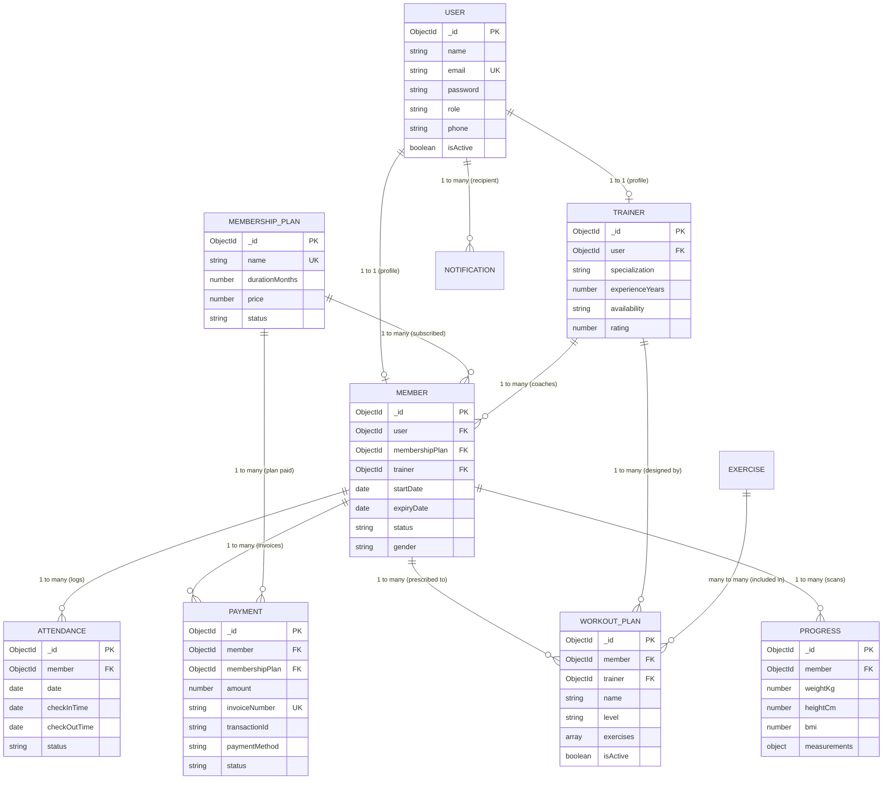

# Database Design & Data Dictionary
## TitanPulse Gym Management System (MongoDB & Mongoose)

---

## 1. Entity-Relationship (ER) Model

---

## 2. Cardinality & Relational Mappings

1. **User $\leftrightarrow$ Member (1-to-1):**
   - Each `Member` references exactly one base `User` entity via `user: ObjectId`.
2. **User $\leftrightarrow$ Trainer (1-to-1):**
   - Each `Trainer` references exactly one base `User` entity via `user: ObjectId`.
3. **MembershipPlan $\leftrightarrow$ Member (1-to-Many):**
   - A single membership plan can be subscribed to by multiple members.
4. **Trainer $\leftrightarrow$ Member (1-to-Many):**
   - A trainer mentors multiple members; tracked both in `member.trainer` and in `trainer.assignedMembers` array.
5. **Member $\leftrightarrow$ Attendance (1-to-Many):**
   - One member has multiple daily attendance records over time.
   - Enforced by compound unique index `{ member: 1, date: 1 }`.
6. **Member $\leftrightarrow$ Payment (1-to-Many):**
   - One member accumulates multiple payment invoice records.
7. **WorkoutPlan $\leftrightarrow$ Exercise (Embedded Many-to-Many):**
   - Exercises are cataloged globally in `exercises` and embedded as sub-documents in `workoutplans.exercises` with plan-specific sets, reps, and rest intervals.
8. **Member $\leftrightarrow$ Progress (1-to-Many):**
   - One member has multiple historical biometric assessment scans.

---

## 3. Comprehensive Data Dictionary

### Collection 1: `users`
| Field Name | Data Type | Constraints / Rules | Description |
| :--- | :--- | :--- | :--- |
| `_id` | ObjectId | Primary Key, Auto-generated | Unique identifier for system user. |
| `name` | String | Required, Trim, Max: 100 chars | Full legal name of user. |
| `email` | String | Required, Unique, Lowercase, Regex | User email used for authentication. |
| `password` | String | Required, Min: 6 chars, `select: false` | Bcrypt encrypted password hash. |
| `role` | String | Enum: `['admin', 'trainer', 'member']` | Access privilege role. |
| `phone` | String | Trim, Default: `''` | Primary contact phone number. |
| `avatar` | String | URL / String, Default: `''` | User profile avatar image link. |
| `isActive` | Boolean | Default: `true` | Account activation state. |
| `createdAt` | Date | Auto-managed timestamp | Timestamp when account was created. |

### Collection 2: `members`
| Field Name | Data Type | Constraints / Rules | Description |
| :--- | :--- | :--- | :--- |
| `_id` | ObjectId | Primary Key | Unique member document identifier. |
| `user` | ObjectId | Required, Unique, Ref: `User` | Foreign key reference to base user. |
| `dob` | Date | Optional | Member date of birth. |
| `gender` | String | Enum: `['male', 'female', 'other']` | Gender specification. |
| `address` | String | Trim | Member physical address. |
| `emergencyContact`| Object | `{ name, phone, relation }` | Emergency contact details. |
| `joinDate` | Date | Default: `Date.now` | Enrollment registration date. |
| `membershipPlan`| ObjectId | Ref: `MembershipPlan`, Default: `null` | Active subscription plan reference. |
| `startDate` | Date | Default: `Date.now` | Current plan activation date. |
| `expiryDate` | Date | Date | Auto-calculated subscription expiration. |
| `trainer` | ObjectId | Ref: `Trainer`, Default: `null` | Assigned personal trainer reference. |
| `status` | String | Enum: `['active', 'expired', 'inactive', 'pending']` | Membership subscription state. |

### Collection 3: `trainers`
| Field Name | Data Type | Constraints / Rules | Description |
| :--- | :--- | :--- | :--- |
| `_id` | ObjectId | Primary Key | Unique trainer document identifier. |
| `user` | ObjectId | Required, Unique, Ref: `User` | Reference to base user account. |
| `specialization`| String | Required, Trim | Strength, HIIT, Crossfit, Yoga, etc. |
| `experienceYears`| Number | Min: 0, Default: 1 | Certified coaching experience. |
| `bio` | String | Trim | Professional trainer biography. |
| `availability` | String | Enum: `['morning', 'evening', 'full-time']` | Working shift schedule. |
| `assignedMembers`| Array | Array of `ObjectId` refs to `Member` | List of coached members. |
| `rating` | Number | Min: 1.0, Max: 5.0, Default: 5.0 | Average client rating. |
| `status` | String | Enum: `['active', 'inactive']` | Staff status. |

### Collection 4: `membershipplans`
| Field Name | Data Type | Constraints / Rules | Description |
| :--- | :--- | :--- | :--- |
| `_id` | ObjectId | Primary Key | Unique plan identifier. |
| `name` | String | Required, Unique, Trim | e.g. "Yearly VIP Platinum". |
| `durationMonths`| Number | Required, Min: 1 | Duration in months (1, 3, 6, 12). |
| `price` | Number | Required, Min: 0 | Package price in USD. |
| `description` | String | Trim | Short marketing description. |
| `features` | Array | Array of Strings | Included benefits (sauna, towels, classes). |
| `status` | String | Enum: `['active', 'inactive']` | Catalog availability. |

### Collection 5: `attendances`
| Field Name | Data Type | Constraints / Rules | Description |
| :--- | :--- | :--- | :--- |
| `_id` | ObjectId | Primary Key | Unique attendance log identifier. |
| `member` | ObjectId | Required, Ref: `Member` | Attendee member reference. |
| `date` | Date | Required | Normalized start-of-day date. |
| `checkInTime` | Date | Default: `Date.now` | Exact timestamp of turnstile check-in. |
| `checkOutTime` | Date | Default: `null` | Exact timestamp of turnstile check-out. |
| `status` | String | Enum: `['present', 'absent', 'late']` | Attendance status. |
| `notes` | String | Default: `''` | Workout or locker note. |
| **Indexes** | Compound Index | `{ member: 1, date: 1 }, { unique: true }` | **Prevents duplicate daily attendance.** |

### Collection 6: `payments`
| Field Name | Data Type | Constraints / Rules | Description |
| :--- | :--- | :--- | :--- |
| `_id` | ObjectId | Primary Key | Unique payment record identifier. |
| `member` | ObjectId | Required, Ref: `Member` | Billed member reference. |
| `membershipPlan`| ObjectId | Required, Ref: `MembershipPlan` | Purchased membership tier. |
| `amount` | Number | Required, Min: 0 | Transaction amount. |
| `paymentDate` | Date | Default: `Date.now` | Settlement timestamp. |
| `paymentMethod`| String | Enum: `['cash', 'upi', 'card', 'bank_transfer']` | Payment channel. |
| `invoiceNumber`| String | Unique, Auto-generated | `INV-YYYY-XXXXX` format. |
| `transactionId`| String | Auto-generated | Internal/external transaction reference. |
| `status` | String | Enum: `['paid', 'pending', 'failed']` | Settlement state. |

### Collection 7: `exercises`
| Field Name | Data Type | Constraints / Rules | Description |
| :--- | :--- | :--- | :--- |
| `_id` | ObjectId | Primary Key | Unique exercise identifier. |
| `name` | String | Required, Unique, Trim | Exercise name (e.g., Bench Press). |
| `category` | String | Enum: `['strength', 'cardio', 'flexibility', 'core']` | Movement category. |
| `targetMuscle` | String | Required | Primary anatomy group targeted. |
| `equipment` | String | Required | Barbell, Dumbbell, Machine, Bodyweight. |
| `instructions` | Array | Array of Strings | Step-by-step execution guidelines. |

### Collection 8: `workoutplans`
| Field Name | Data Type | Constraints / Rules | Description |
| :--- | :--- | :--- | :--- |
| `_id` | ObjectId | Primary Key | Unique workout plan identifier. |
| `name` | String | Required, Trim | Name of the training routine. |
| `member` | ObjectId | Required, Ref: `Member` | Athlete receiving the routine. |
| `trainer` | ObjectId | Ref: `Trainer`, Default: `null` | Prescribing coach. |
| `goal` | String | Goal string (e.g., Hypertrophy) | Training objective. |
| `level` | String | Enum: `['beginner', 'intermediate', 'advanced']` | Difficulty classification. |
| `exercises` | Array | Embedded `[workoutExerciseSchema]` | Array of movements, sets, reps, rest. |
| `isActive` | Boolean | Default: `true` | Plan active state. |

### Collection 9: `progresses`
| Field Name | Data Type | Constraints / Rules | Description |
| :--- | :--- | :--- | :--- |
| `_id` | ObjectId | Primary Key | Unique progress record identifier. |
| `member` | ObjectId | Required, Ref: `Member` | Assessed member reference. |
| `date` | Date | Default: `Date.now` | Date of biometric evaluation. |
| `weightKg` | Number | Required, Min: 20, Max: 300 | Measured bodyweight in kilograms. |
| `heightCm` | Number | Required, Min: 50, Max: 250 | Measured height in centimeters. |
| `bmi` | Number | Auto-calculated in pre-save hook | $weight / (height/100)^2$. |
| `measurements` | Object | `{ chestCm, waistCm, hipsCm, armsCm, thighsCm }` | Body circumference metrics. |

### Collection 10: `notifications`
| Field Name | Data Type | Constraints / Rules | Description |
| :--- | :--- | :--- | :--- |
| `_id` | ObjectId | Primary Key | Unique notification identifier. |
| `recipient` | ObjectId | Ref: `User`, Default: `null` | `null` signifies system-wide broadcast. |
| `title` | String | Required, Trim | Short announcement title. |
| `message` | String | Required | Full announcement body text. |
| `type` | String | Enum: `['info', 'alert', 'payment', 'workout']` | Notification icon and color category. |
| `isRead` | Boolean | Default: `false` | Read confirmation state. |
